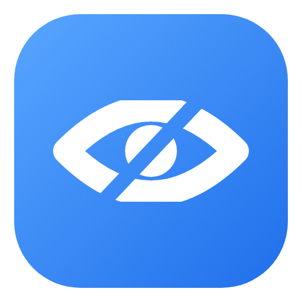
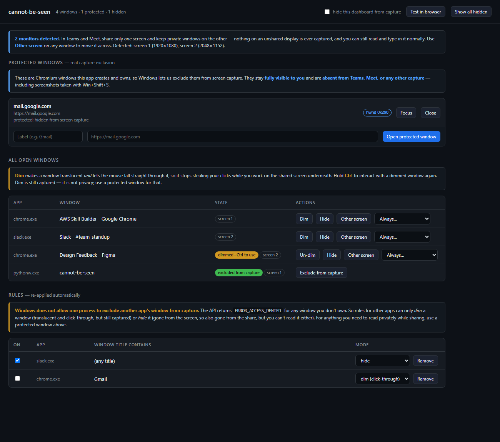

# cannot-be-seen

A Windows tray app that keeps chosen windows out of your screen share — Teams,
Google Meet, Zoom, or anything else that captures the screen.



It works by creating the windows itself. That is the whole trick, and the
limitation section below explains why there is no way around it.

---

## Download and run

1. **Download** this repository (green *Code* button → *Download ZIP*, or `git clone`).
2. **Double-click `setup.cmd`.** It creates a virtual environment and installs
   three packages. Takes about a minute.
3. **Double-click `start.cmd`.** The app appears as a tray icon — an eye with a
   slash.

That is it. To have it start with Windows, put a shortcut to `start.cmd` in
`shell:startup`.

### Requirements

- Windows 10 version 2004 or newer (the capture-exclusion API arrived in that
  release; Windows 11 is what this is developed and tested on).
- Python 3.10+ on your PATH. `setup.cmd` will tell you if it cannot find it.
- The Microsoft Edge **WebView2 runtime**, which is what the protected windows
  are built on. It ships with Windows 11 and with current Edge installs; if it is
  somehow missing, get it from
  [Microsoft's page](https://developer.microsoft.com/microsoft-edge/webview2/).

Nothing is compiled and no admin rights are needed — it is plain Python plus
`ctypes`.

---

## The one thing to understand first

Windows has an API for exactly this: `SetWindowDisplayAffinity(hwnd, WDA_EXCLUDEFROMCAPTURE)`.
A window with that affinity stays fully visible on your monitor but is **absent
from every screen-capture API** — the same APIs Teams and Meet read from.

The catch, straight from the Microsoft docs:

> `hWnd` — A handle to the top-level window. **The window must belong to the
> current process.**

Verified on Windows 11 build 26200:

| Target | Result |
| --- | --- |
| A window owned by our own process | `WDA_EXCLUDEFROMCAPTURE` applied |
| Another app's window (Chrome, Notepad, …) | fails, `GetLastError() == 5` (`ERROR_ACCESS_DENIED`) |
| Transparency on another app's window | works, but is only a visual effect — it is still captured |

So a tool that reaches into Chrome and makes *its* window invisible to capture
cannot exist through supported APIs. Anything claiming otherwise is injecting
code into the other process — which trips antivirus, breaks browser sandboxes,
and is not what this app does.

**Therefore: the windows this app can genuinely protect are the ones it opens
itself.** Those are real Chromium (WebView2) windows — normal browser windows
you can point at any site — so for the "private tab I need to read during a
call" case, they do the job properly.

For other apps' windows you get the two honest fallbacks described below.

---

## What you get

### Protected windows — real capture exclusion

Open one from the dashboard or the tray. It is a Chromium window this app owns,
so the OS lets us exclude it. It stays fully visible to you and is missing from
Teams/Meet/Zoom and from `Win+Shift+S` screenshots.

Each one carries a small navigation bar — back, forward, reload, an address
field, and buttons to open another protected window or close this one. Keyboard:
`Alt+←`/`Alt+→`, `F5` or `Ctrl+R`, `Ctrl+L` for the address field, `Ctrl+W` to
close. So it works as a real browser you can read and type in during a call,
rather than a bare content pane.

#### Signing in to sites

**You sign in once and stay signed in.** The protected windows share a browser
profile kept on disk at `%LOCALAPPDATA%\cannot-be-seen\webview`, so cookies,
localStorage and sessions survive restarts. Log into Facebook, tick its own
"remember me", and you will not be asked again — including across app restarts.

This works because the app runs the WebView2 engine with `private_mode=False` and
a fixed `storage_path`. pywebview defaults to a throwaway profile that is deleted
on exit, which is what forces a fresh login every launch. `tests/check_profile_persistence.py`
proves it: one process writes a cookie and a localStorage entry, a second process
reads them back.

Two limits worth knowing:

- It is **not your Chrome profile** — no shared logins, bookmarks or extensions
  with Chrome itself. You sign in inside the protected windows separately.
- WebView2 does not expose the Edge **password manager**, so it will not offer to
  save passwords for you. Session persistence is the mechanism here, not a saved
  password. If a session does expire you will log in again.

### Rules for other apps — dim or hide

**Nothing in this section hides a window from a share.** It cannot: Windows
refuses to let one process exclude another app's window from capture, which is
the entire reason this app creates its own windows in the first place. When the
point is privacy, use a **protected window** (above) or your **second monitor**
(below).

Rules are about workflow, not concealment. A rule matches windows by app and/or
title and is re-applied continuously, so a window you close and reopen is covered
again automatically.

| Mode | What it does | Hides from a share? |
| --- | --- | --- |
| **dim** | Translucent and click-through, so it stops stealing clicks while you work on the shared screen behind it | **No.** Dim is a convenience, not privacy — the pixels are still captured, just fainter. May also render oddly on GPU-composited apps like Chrome. |
| **hide** | Removes the window from the screen entirely | **Yes**, because it is not on screen at all — but you cannot read it either. |

**Dim is click-through.** A dimmed window lets the mouse fall straight through it,
so it stops stealing clicks while you work on the shared screen underneath.
**Hold Ctrl** to interact with it again (click, scroll, select). Windows has no
"click-through unless a modifier is held" flag, so the app polls the key state and
toggles `WS_EX_TRANSPARENT` itself.

**Pinning is per window.** **Pin** on any row raises that one window above
everything else, so it stays where you put it instead of vanishing behind whatever
you click; **Unpin** puts it back in the normal stack. Pinning is independent of
dimming — dimming never changes it, so a window keeps whatever you chose for it.
That is deliberate: you can have one dimmed window pinned as a reference and
another dimmed but left in the stack.

**How see-through it is** is up to you: the **Dim transparency** slider runs
from 0% (nearly solid) to 90% (barely there), applies to every dimmed window the
moment you move it, and is remembered between launches.

Because Ctrl is a common modifier, note that pressing it for anything else — a
`Ctrl+C`, say — briefly makes dimmed windows clickable too. That is inherent to
asking for a Ctrl-held affordance.

"Show all hidden" restores everything and switches off the rules that were
holding windows down, so they do not immediately disappear again.

### Your real Chrome, via a second monitor

This is the route that works for apps the app cannot touch. When you pick
"entire screen" in Teams or Meet you share **one** monitor; anything on a display
you are not sharing is never captured at all — no API tricks involved, and you can
read and type in it exactly as normal.

So: keep real Chrome on your second display, share only your primary one.

**Other screen** on any row in the dashboard moves that window across in one
click, and each row shows which display it is currently on. The dashboard reports
how many monitors it found, so you can tell at a glance whether this route is
available to you.

### Window tracking

The dashboard lists every visible top-level window with its state and offers the
per-window actions above.

---

## Run

```
start.cmd
```

or directly, without a console window:

```
.venv\Scripts\pythonw.exe run.pyw
```

It starts as a tray icon (an eye with a slash). The dashboard window is
excluded from capture by default — untick **hide this dashboard from capture**
in the header if you would rather it appear in your shares.

### Running from source without the scripts

```
python -m venv .venv
.venv\Scripts\python -m pip install -r requirements.txt
.venv\Scripts\pythonw run.pyw
```

## Verify that it really works

Two ways, in increasing order of realism:

1. **`tests\check_capture_exclusion.py`** — opens a protected window, reads the
   affinity back, and prints PASS/FAIL.

   ```
   .venv\Scripts\python tests\check_capture_exclusion.py
   ```

2. **The capture test page** — click **Test in browser** in the dashboard. It
   captures your screen with `getDisplayMedia`, the exact browser API Meet and
   Teams-on-web use, and shows you the live capture next to a frozen snapshot.
   Put a protected window over the page: it stays on your screen and is absent
   from the capture.

   `Win+Shift+S` is a quick third check — the Windows 11 Snipping Tool captures
   through the same modern API, so the protected window is missing from the
   snip. See the caveat about older capture paths below.

The definitive check is a real meeting: start a share, put a protected window on
screen, and confirm nobody reacts to it.

## Tests

```
.venv\Scripts\python tests\check_capture_exclusion.py   # protected window is excluded
.venv\Scripts\python tests\check_browser.py             # nav bar, bridge, right window claimed
.venv\Scripts\python tests\check_profile_persistence.py # logins survive a restart
.venv\Scripts\python tests\check_screens.py             # move a window to the other display
.venv\Scripts\python tests\check_click_through.py       # dim: click-through, pinned, Ctrl, alpha
.venv\Scripts\python tests\check_rules.py               # dim / hide / re-hide / manual dim sticks
```

They open windows briefly; `check_capture_exclusion.py` holds one open for a few
seconds so you can try `Win+Shift+S`. `check_screens.py` skips itself if you only
have one monitor. `check_profile_persistence.py` needs network access, since it
uses a real origin.

To ask Windows directly whether another app's window can be excluded:

```
.venv\Scripts\python tools\probe_capture_exclusion.py chrome.exe
```

It tries the call on your Chrome window and on a window of its own, and prints
what Windows says to each. The answer to the first is always `Access is denied`.

To look at the dashboard itself without opening it:

```
.venv\Scripts\python tools\render_ui.py     # writes shot-ui.png
```

The real dashboard can't be screenshotted — it excludes itself from capture by
default, and WebView2 does not render into `PrintWindow` — so this loads the same
HTML in headless Edge with a stubbed bridge.

To regenerate the logo assets after editing `docs/logo.svg`:

```
.venv\Scripts\python tools\render_logo.py   # docs/logo.png + cbs/assets/icon.png
```

The tray icon is rendered from the same vector source, so the two cannot drift
apart. Pillow cannot punch the slash out of the eye (that needs an SVG mask),
which is why the renderer is a headless browser rather than PIL.

---

## Layout

```
setup.cmd                     one-time setup: venv + dependencies
start.cmd                     launcher without a console window
run.pyw                       entry point
requirements.txt              pystray, pillow, pywebview
cbs/win32api.py               ctypes bindings, no native build step
cbs/tracker.py                enumerates on-screen windows
cbs/protect.py                capture exclusion, dim, hide
cbs/interact.py               Ctrl-held gate for click-through windows
cbs/screens.py                monitor detection and window moving
cbs/rules.py                  persisted rules + the re-apply loop
cbs/browser.py                protected WebView2 windows
cbs/app.py                    dashboard wiring and the JS bridge
cbs/tray.py                   tray icon and menu
cbs/assets/index.html         dashboard
cbs/assets/toolbar.js         navigation bar injected into protected windows
cbs/assets/verify.html        capture test page
cbs/assets/icon.png           tray icon, rendered from the logo
tests/                        the checks listed above
tools/render_ui.py            renders the dashboard to a PNG
tools/render_logo.py          renders the logo assets from docs/logo.svg
tools/probe_capture_exclusion.py  asks Windows whether a foreign window can be excluded
docs/logo.svg                 the logo, as a vector
docs/logo.png                 the logo, rasterised
docs/screenshot.png           dashboard image used above
```

## License

MIT — see [LICENSE](LICENSE).

Config lives in `%LOCALAPPDATA%\cannot-be-seen\config.json`.

## Gotchas

- Protected windows are Chromium windows, not your real Chrome profile. They do
  not share logins or extensions with Chrome. Most sites work normally; sites
  that block embedded browsers will not.
- The navigation bar is drawn *over* the page, so it covers roughly the top 38px
  of whatever you load. Sites with their own fixed header will have it partially
  hidden. That is the trade for not being able to use a real browser toolbar.
- The app can only protect windows it owns. It cannot reach into Chrome, and it
  will tell you so rather than pretending otherwise.
- `dim` on a hardware-composited window (Chrome, Edge) sometimes renders the
  window black instead of translucent. That is a Windows composition quirk, not
  something this app can fix — use `hide` or a protected window instead.
- Capture exclusion applies to the modern capture stack — Windows.Graphics.Capture
  and Desktop Duplication, which is what Teams, Meet, Zoom and the Windows 11
  Snipping Tool read from. **Legacy GDI screen grabs still see the window.**
  A `BitBlt`-based capture (some older screenshot utilities, and Python's
  `PIL.ImageGrab`) will happily record a protected window. That is a limitation
  of those tools, not a failure of the exclusion, but it is worth knowing before
  you trust it.
- Sharing a *single window* rather than the whole screen is a different path:
  whatever you explicitly pick is captured normally, protected or not.
